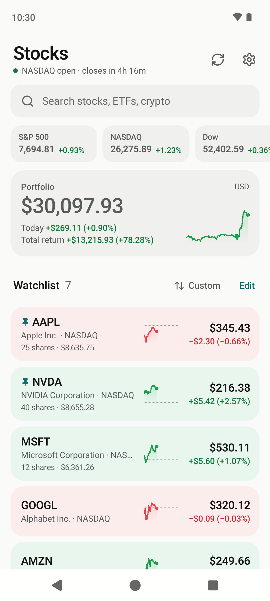
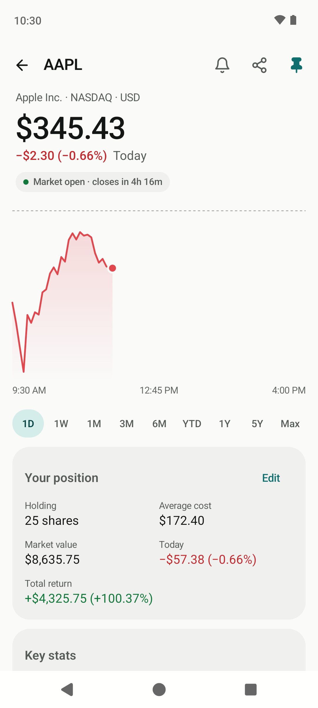
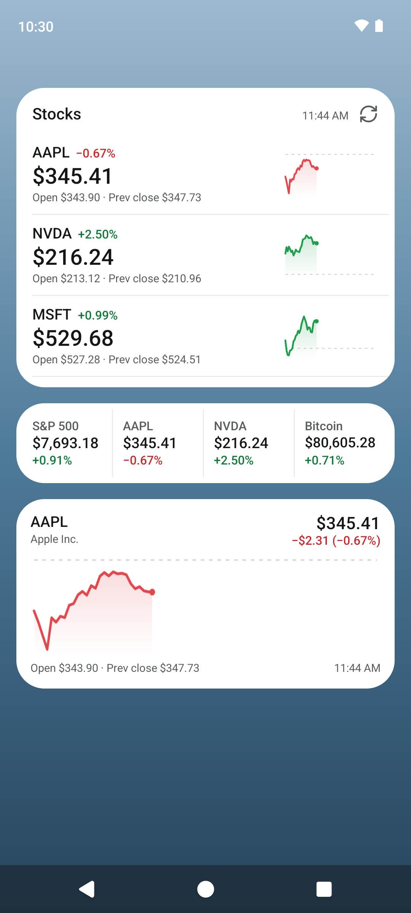
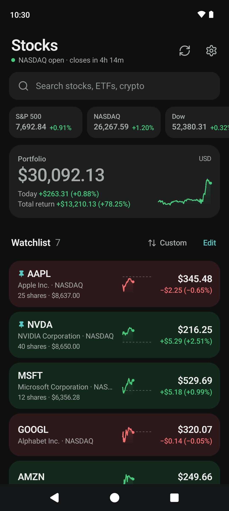
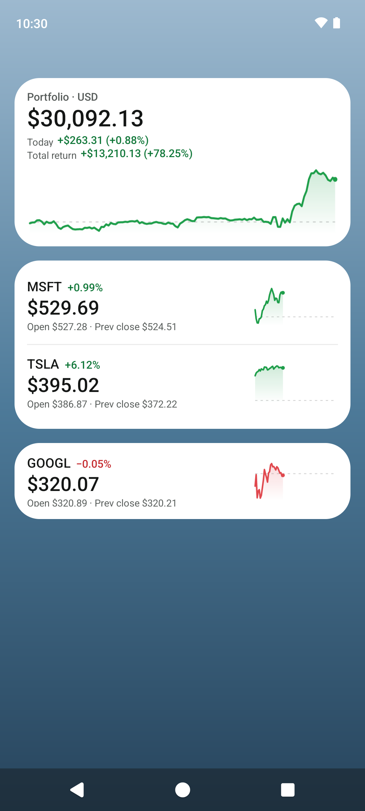

# Stock Widget

A light, fast Android app and set of home-screen widgets for keeping an eye on stocks, ETFs, indices and crypto. No account, no ads, no tracking.

- **Your list at a glance.** Prices, today's change in percent and amount, and a sparkline for every stock, on cards tinted green or red.
- **Six widgets.** A scrollable list, one stock, two stocks, a 4×1 ticker strip, your portfolio, and a big chart. Each can follow the system theme or use its own light, dark or pure black theme, and shows the open and previous close.
- **Detail that answers questions.** Charts from 1 day to all time with drag-to-inspect, key stats with day and 52-week ranges, distance from the 52-week high and low, value traded and trading hours, pre- and after-hours prices, news headlines and your own notes.
- **Your portfolio, optionally.** Add shares and an average cost to see the value, today's change and your total return, converted into one home currency.
- **Simple price alerts.** Get notified when a stock goes above or below a price, or moves more than a set percentage in a day.
- **Gentle on battery.** Background refreshes run only while the markets you follow are open (crypto keeps going), and every refresh is shared by the app and all widgets.
- **Made for Android.** Material 3, Light, Dark or System theme, a pure black option for OLED, wallpaper colors on Android 12+, a two-pane layout on tablets and foldables, and app-icon shortcuts.

<p align="center">
  
  
  
  
</p>

Prices come from Yahoo Finance's public endpoints and may be delayed. The app is for information only and is not investment advice.

## Install

Download the latest APK from [Releases](https://github.com/sebytzr16/stock-widget/releases) and open it on your phone. Android 8.0 or newer is required.

Listings on F-Droid and IzzyOnDroid are planned.

## Widgets

| Widget | Default size | Shows |
| --- | --- | --- |
| Stock list | 4×3 | Your list, in the app's order, with a refresh button |
| One stock | 3×1 | Price, change, open and previous close, chart |
| Two stocks | 3×2 | Two of the above, stacked |
| Ticker strip | 4×1 | Up to four stocks side by side |
| Portfolio | 3×2 | Total value, today's change, total return, chart |
| Chart | 4×2 | A large intraday chart for one stock |

When you add a widget you pick its stocks and its theme: System, Light, Dark or Black (pure black with a faint outline, so it shows on a black wallpaper). Long-press a placed widget and choose **Reconfigure** (Android 12+) to change them, or tap an empty widget to pick its stocks.

<p align="center">
  
  
</p>

## Privacy

The app talks only to Yahoo Finance, to fetch prices, charts, search results and headlines for the symbols you follow. Everything you enter stays on your device. See [PRIVACY.md](PRIVACY.md).

## Build

Open the project in Android Studio, or build from the command line with JDK 17:

```sh
./gradlew assembleDebug          # app/build/outputs/apk/debug/
./gradlew testDebugUnitTest      # unit tests for the core logic
```

Release builds are minified with R8. Signing is set up through `keystore.properties` or environment variables; see [RELEASING.md](RELEASING.md).

### Project layout

```
app/src/main/java/io/github/sebytzr16/stockwidget/
  core/      Plain Kotlin, no Android: models, Yahoo client and parser, formatting,
             market hours, portfolio math, alert rules, JSON storage. Unit tested.
  data/      Repository: the single source of truth, refresh logic and caching.
  ui/        Jetpack Compose screens: home, search, detail, settings, navigation.
  widget/    The six widgets, their rendering and the setup screen.
  work/      WorkManager background refresh.
  system/    Notifications, app-icon shortcuts, share card.
```

The app keeps its dependencies small: AndroidX Core, Activity, Lifecycle, Compose Material 3 and WorkManager. Networking uses the platform's HTTP client and JSON parser.

## Contributing

Issues and pull requests are welcome. See [CONTRIBUTING.md](CONTRIBUTING.md).

## License

[MIT](LICENSE). Stock Widget is not affiliated with Yahoo. Icons are drawn from [Lucide](https://lucide.dev) (ISC license); see [NOTICE.md](NOTICE.md) for third-party notices.
